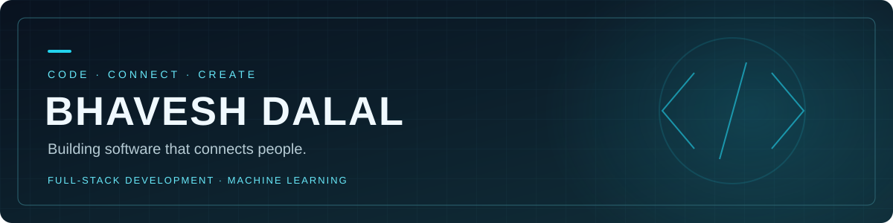

  

<h3 align="center">Bhavesh Dalal | Full-stack development &amp; Machine Learning</h3>

Turning practical problems into connected web experiences.

  <a href="https://github.com/BhaveshDalal22">GitHub</a> ·
  <a href="https://github.com/BhaveshDalal22/LifeLink">Explore LifeLink</a>

---

### About me

I'm Bhavesh, building web applications that bring interfaces, APIs, databases, and maps together. My project **LifeLink** explores how software can help coordinate emergency healthcare through clear workflows for patients, hospital staff, ambulance drivers, and administrators.

- 🛠️ **Building:** full-stack applications with React, Node.js, Express, and MySQL.
- 📍 **Project focus:** location-based search, hospital matching, and emergency response tracking.
- 🔐 **Implementation:** role-based access, JWT authentication, and ownership-scoped authorization.
- 🧠 **Machine learning:** legal text classification, passage retrieval, and extractive summarization with Python.

### Selected projects

| Project | What I built |
| :--- | :--- |
| [**LifeLink**](https://github.com/BhaveshDalal22/LifeLink) | An emergency healthcare coordination demo with four role-based dashboards, hospital recommendations, nearest-ambulance matching, maps, and status tracking. |
| [**AI-Based Legal Case Intelligence**](https://github.com/BhaveshDalal22/law) | A local Python application for historical IPC label suggestions, supporting passage retrieval, extractive summaries, and legal reference extraction, with a FastAPI backend and Streamlit interface. |

### Inside LifeLink

- **Patient workflow:** report an emergency, find hospitals, request admission, and track response status.
- **Hospital workflow:** manage resource availability and respond to admission requests.
- **Ambulance workflow:** receive requests and update trip progress.
- **Admin workflow:** manage hospitals and users, review platform activity, and oversee requests.
- **Matching logic:** transparent scoring based on specialization, resource availability, and distance.

LifeLink is an academic demo using fictional hospital and ambulance data. Status tracking uses periodic polling.

### Toolkit

**Languages:** Python · JavaScript · SQL · HTML · CSS  
**ML & legal text:** scikit-learn · TF-IDF · Logistic Regression · Extractive Summarization  
**Python apps:** FastAPI · Streamlit · SQLite · PyMuPDF  
**Frontend:** React · Vite · Tailwind CSS · React Router · Axios · Lucide React  
**Backend & data:** Node.js · Express.js · MySQL · JWT · bcrypt.js  
**Maps & location:** Leaflet · React Leaflet · OpenStreetMap · Browser Geolocation API

### Project highlights

- Built a legal text analysis workflow combining multilabel classification, source-linked retrieval, and extractive summaries.
- Connected four user roles through a shared healthcare coordination workflow.
- Combined interactive maps with distance-based hospital and ambulance discovery.
- Implemented protected routes and access rules scoped to each user's role and records.

---

<b>Build with purpose. Connect through code.</b>

